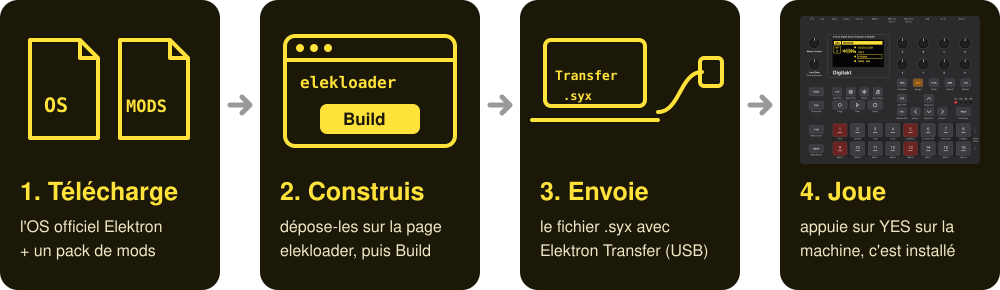
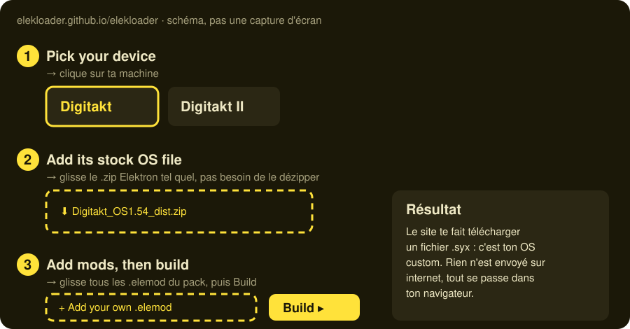
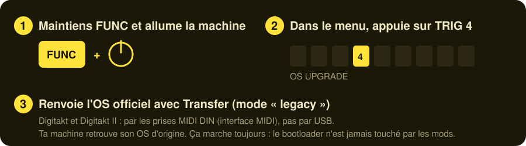

# Guide pas à pas : installer des mods sur ta Digitakt

Pas besoin de connaître GitHub, ni de programmer. Il te faut un ordinateur, ta Digitakt, son câble USB et environ
20 minutes. Tu ne télécharges que des fichiers, et tout se fait en cliquant.

---

## Avant de commencer

| | |
|---|---|
| ✅ **Ta machine** | une **Digitakt** (la première) ou une **Digitakt II** : c'est écrit sur l'appareil |
| ✅ **Le câble USB** | celui qui relie la Digitakt à l'ordinateur |
| ✅ **Elektron Transfer** | le logiciel gratuit d'Elektron, à installer depuis [elektron.se/support-downloads/transfer](https://www.elektron.se/support-downloads/transfer) |
| ✅ **Une sauvegarde** | sauvegarde tes projets importants, comme avant n'importe quelle mise à jour |

> ⚠️ **Ce ne sont pas des mises à jour officielles d'Elektron.** Tu les installes à tes risques. Tu peux toujours
> revenir en arrière (voir [Si ça ne marche pas](#si-ça-ne-marche-pas)).

> ⚠️ **Digitakt II :** les machines DIGISLICER, POLY, STRING, DT-FM, MONO… n'existent **que sur la première
> Digitakt**. Sur la Digitakt II, il n'y a pour l'instant que le pack « PERFORM KIT ».

---

## Étape 1 : télécharge deux fichiers

### 1a. L'OS officiel de ta machine

C'est le « système » de la Digitakt, tel qu'Elektron le publie. elekloader s'en sert de base.

| ta machine | va sur | télécharge le fichier |
|---|---|---|
| Digitakt | [elektron.se → Digitakt](https://www.elektron.se/support-downloads/digitakt) | `Digitakt_OS1.54_dist.zip` |
| Digitakt II | [elektron.se → Digitakt II](https://www.elektron.se/support-downloads/digitakt-ii) | `Digitakt_II_OS1.17_dist.zip` |

**Ne le dézippe pas**, garde-le tel quel. Pas besoin de savoir quelle version tourne sur ta machine : celle-ci la
remplacera.

### 1b. Un pack de mods

Clique sur un pack : le fichier se télécharge. **Double-clique dessus** pour le dézipper : tu obtiens un dossier
plein de fichiers qui finissent par `.elemod`. Ce sont les mods.

| pack | ce qu'il y a dedans | télécharger |
|---|---|---|
|       **Digitakt « on crack »** | les machines qu'on voit en story : SLICER, POLY, STRING, DT-FM, MONO, CHORDS, DH-101 | [⬇ pack-graete-1.54.zip](https://github.com/hillzeealex/digitakt-mods/releases/latest/download/pack-graete-1.54.zip) |
|      **Max synthés** | tout le pack précédent, plus MACRO (Plaits), NEIGHBOR, la matrice de modulation, le scope, l'EQ et DIGISNAKE | [⬇ pack-max-synth-1.54.zip](https://github.com/hillzeealex/digitakt-mods/releases/latest/download/pack-max-synth-1.54.zip) |
|    **Effets** | Tone+FX (ring mod, wavefolder, bitcrusher…), nouveaux filtres, SLICER | [⬇ pack-fx-1.54.zip](https://github.com/hillzeealex/digitakt-mods/releases/latest/download/pack-fx-1.54.zip) |
|   **OB-1 + SOPHIE** | l'oscillateur Oberheim OB-1 et la percussion métallique SOPHIE, avec MONO, DH-101, SLICER, POLY, STRING | [⬇ pack-ob1-sophie-1.54.zip](https://github.com/hillzeealex/digitakt-mods/releases/latest/download/pack-ob1-sophie-1.54.zip) |
|   **Digitakt II : PERFORM KIT** | [PRESET] seul active PERFORM KIT, et tes niveaux de piste sont gardés quand tu en sors | [⬇ pack-perform-1.17.zip](https://github.com/hillzeealex/digitakt-mods/releases/latest/download/pack-perform-1.17.zip) |

Le premier pack est le plus sûr pour commencer : c'est celui qui laisse le plus de marge à la machine.

> Le lien affiche « 404 » ? Le dépôt est privé : connecte-toi à GitHub avec le compte qui a été invité.

---

## Étape 2 : construis ton OS sur elekloader

Ouvre **<https://elekloader.github.io/elekloader/>** dans ton navigateur (Chrome, Firefox ou Safari). Rien à
installer : le site fait tout dans ta page, et rien n'est envoyé sur internet.

1. **Pick your device** : clique sur ta machine.
2. **Add its stock OS file** : glisse le `.zip` Elektron de l'étape 1a sur la page.
3. **Add mods, then build** : sélectionne **tous** les fichiers `.elemod` du dossier du pack, glisse-les sur la page,
   puis clique sur **Build**. S'ils apparaissent sous « Your files » sans être ajoutés à la build, clique sur
   **+ Add** sur chacun.

Le site te fait alors télécharger un fichier qui finit par **`.syx`** : c'est ton OS custom.

> Un message rouge ? C'est que les fichiers ne vont pas ensemble, par exemple un pack Digitakt avec un OS Digitakt
> II. Vérifie que tu as pris le bon OS et le bon pack.

---

## Étape 3 : envoie-le dans la Digitakt

1. Branche la Digitakt à l'ordinateur en **USB** et allume-la.
2. Ouvre **Elektron Transfer** et connecte-toi à la Digitakt.
3. Laisse la machine sur son écran principal, et **glisse le fichier `.syx`** dans la fenêtre de Transfer.
4. Attends la fin du transfert. La Digitakt te demande de confirmer : appuie sur **YES**.
5. Elle redémarre toute seule. C'est installé.

---

## Étape 4 : où trouver tes nouveaux jouets

| quoi | où |
|---|---|
| les nouvelles machines (SLICER, POLY, STRING, DT-FM, MONO…, DH-101) | page **SRC** d'une piste, liste **MACHINE** (double-clic sur SRC, ou FUNC + SRC) |
|  FAST AUDIO et SYSTEM INFO (digihealth) | dans **SETTINGS** ; active FAST AUDIO si tu joues plusieurs synthés à la fois |
|  la matrice de modulation | **SETTINGS → MOD MATRIX** |
|  le scope, le spectre et l'accordeur | maintiens la touche **« ... »** |
|  PERFORM KIT (Digitakt II) | appuie sur **[PRESET]** seul ; FUNC + PRESET ouvre le menu PRESET/KIT |

Les synthés demandent beaucoup au processeur de la machine. Si le son coupe, joue sur moins de pistes de synthé à
la fois, ou active FAST AUDIO.

---

## Si ça ne marche pas

La machine ne démarre plus, ou fait n'importe quoi ? **Pas de panique : les mods ne touchent jamais à la partie qui
démarre la machine.** Tu peux toujours remettre l'OS officiel :

Pour l'étape 3, dézippe le `.zip` Elektron : il contient le fichier `.syx` officiel à renvoyer.

---

## Questions

**Je peux casser ma machine ?** Le risque existe, comme avec tout firmware non officiel. Mais la partie qui démarre
la machine (le bootloader) n'est jamais modifiée : on peut toujours revenir à l'OS officiel.

**Je veux revenir à la normale.** Envoie le `.syx` officiel avec Transfer, comme à l'étape 3.

**Je veux un mod qui n'est dans aucun pack.** Tous les mods sont listés dans le [README](../README.md). Télécharge
son fichier, et ajoute-le au reste à l'étape 2. Si deux mods ne vont pas ensemble, elekloader te le dit avant de
construire quoi que ce soit.
