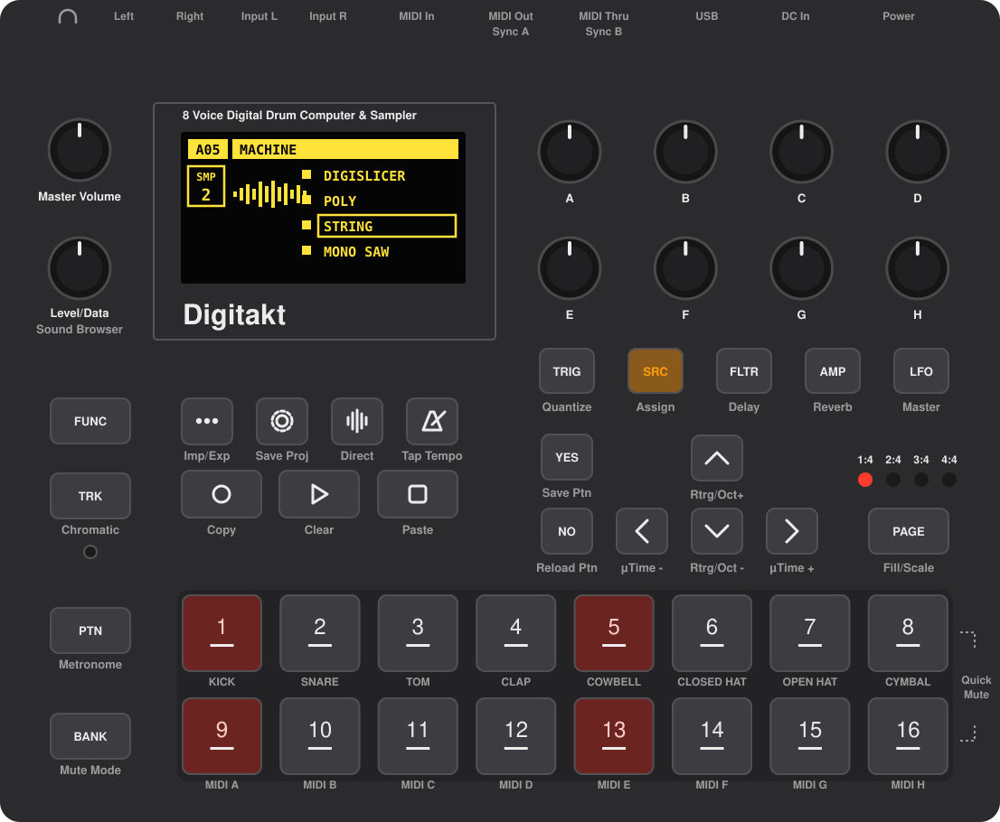

# Installer des mods sur ta Digitakt

Sans savoir coder. Il te faut ta machine, son câble USB, un ordinateur et 20 minutes.

Regarde ce qui est écrit sous l'écran : **[Digitakt](#digitakt)** ou **[Digitakt II](#digitakt-ii)** ?

> **Attention :** si un jour la machine ne démarre plus, la réparation passe par une **interface MIDI** (les prises
> rondes), pas par l'USB. C'est la même chose sur les deux Digitakt. Sans interface MIDI, ne l'installe pas.

---

## Digitakt

Tu ajoutes les synthés de la story : DIGISLICER, POLY, STRING, DT-FM, MONO, CHORDS et DH-101.

**1. Télécharge ces 2 fichiers** (et installe [Elektron Transfer](https://www.elektron.se/support-downloads/transfer) si tu ne l'as pas)

Double-clique sur le **pack** pour l'ouvrir (sur Windows : clic droit, puis **Extraire tout**). Laisse le fichier
Elektron tel quel.

**2. Fabrique ton OS** sur [elekloader](https://elekloader.github.io/elekloader/)

Clique sur **Digitakt**. Glisse le fichier Elektron, puis les 8 fichiers du pack, et clique sur **Build**. Un fichier
`.syx` se télécharge : c'est ton OS avec les mods.

**3. Envoie-le dans la Digitakt**

Branche-la en USB et ouvre **Transfer**. Glisse le `.syx` dans la fenêtre, puis appuie sur **YES** sur la machine.
Elle redémarre toute seule.

Pas de Transfer ? [Envoie-le depuis cette page](envoyer.html), avec Chrome ou Edge sur ordinateur (nouveau).

**4. Joue**

Maintiens **FUNC** et appuie sur **SRC**. Choisis une machine avec les flèches **HAUT** / **BAS**, puis appuie sur
**YES**.

---

## Digitakt II

Tu ajoutes deux améliorations de PERFORM KIT : **[PRESET]** seul l'active, et tes niveaux de piste restent quand tu
en sors. Les synthés de la Digitakt (STRING, POLY…) n'existent pas sur la Digitakt II.

Ensuite, fais comme pour la Digitakt ([étapes 2 et 3](#etape-2)), en cliquant sur **Digitakt II** et en glissant les
3 fichiers du pack.

---

<b>Si ça plante</b>

Pas de panique : les mods ne touchent jamais à la partie qui démarre la machine. Tu peux toujours remettre l'OS
officiel. Le fichier `.syx` à renvoyer est dans le `.zip` Elektron : double-clique dessus pour le sortir.

**Si elle démarre encore**, renvoie l'OS officiel comme à l'étape 3, en USB.

**Si elle ne démarre plus**, branche une interface MIDI sur ses prises rondes, puis :

<b>Les mots bizarres</b>

| mot | ce que c'est |
|---|---|
| **OS** | le logiciel qui tourne dans ta Digitakt |
| **.zip** | un fichier qui en contient d'autres ; on l'ouvre par un double-clic |
| **.elemod** | un mod, qui ajoute une fonction |
| **.syx** | le fichier qu'on envoie à la Digitakt pour changer son OS |
| **elekloader** | le site qui mélange l'OS officiel et les mods |
| **Transfer** | le logiciel d'Elektron qui envoie des fichiers à la machine |

<b>Comment se servir de chaque mod</b> (modes d'emploi de leurs auteurs, en anglais)

| | mod | mode d'emploi |
|---|---|---|
|  | DIGISLICER | [irpina/digislicer](https://github.com/irpina/digislicer#readme) |
|  | POLY, MONO, CHORDS, MACRO, MATRIX, EQ, scope | [digi1_mods](https://github.com/gdeo607/digi1_mods/blob/main/docs/USAGE.md) |
|  | DH-101 | [digi1_mods, DH-101](https://github.com/gdeo607/digi1_mods/blob/main/mods/digi101/README.md) |
|  | STRING | [Alez22/digistring](https://github.com/Alez22/digistring#readme) |
|  | DT-FM | [mtalikka/DT-FM](https://github.com/mtalikka/DT-FM#readme) |
|  | FAST AUDIO, SYSTEM INFO | [irpina/digihealth](https://github.com/irpina/digihealth#readme) |
|  | NEIGHBOR | [irpina/digineighbor](https://github.com/irpina/digineighbor#readme) |
|  | SOPHIE | [soejrd/digisophie](https://github.com/soejrd/digisophie#readme) |
|  | OB-1 | [simonjohansson/elektrob-1](https://github.com/simonjohansson/elektrob-1#readme) |
|  | Tone+FX | [DigiAlchemydsp/Tone-FX](https://github.com/DigiAlchemydsp/Tone-FX#readme) |
|  | DigiFilter | [DigiAlchemydsp/DigiFilter](https://github.com/DigiAlchemydsp/DigiFilter#readme) |
|  | DIGISEQ | [ClaidArremer/digitakt-digiseq](https://github.com/ClaidArremer/digitakt-digiseq#readme) |
|  | DIGISNAKE | [ClaidArremer/digitakt-digisnake](https://github.com/ClaidArremer/digitakt-digisnake#readme) |
|  | PERFORM KIT (Digitakt II) | [toonst/digitakt2-perform](https://github.com/toonst/digitakt2-perform#readme) |

<b>D'autres packs, chaque mod un par un</b>

Max synthés, effets, OB-1 + SOPHIE, et le téléchargement de chaque mod séparément : tout est sur la
[page du projet](https://github.com/hillzeealex/digitakt-mods#les-packs). Ça s'installe de la même façon, seul le
pack change.

Ces mods ne viennent pas d'Elektron : tu les installes à tes risques. Sauvegarde tes projets importants avant,
comme pour n'importe quelle mise à jour.
